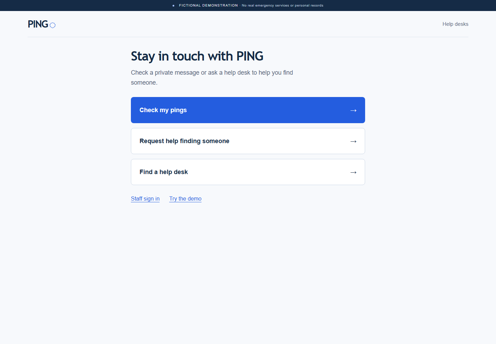
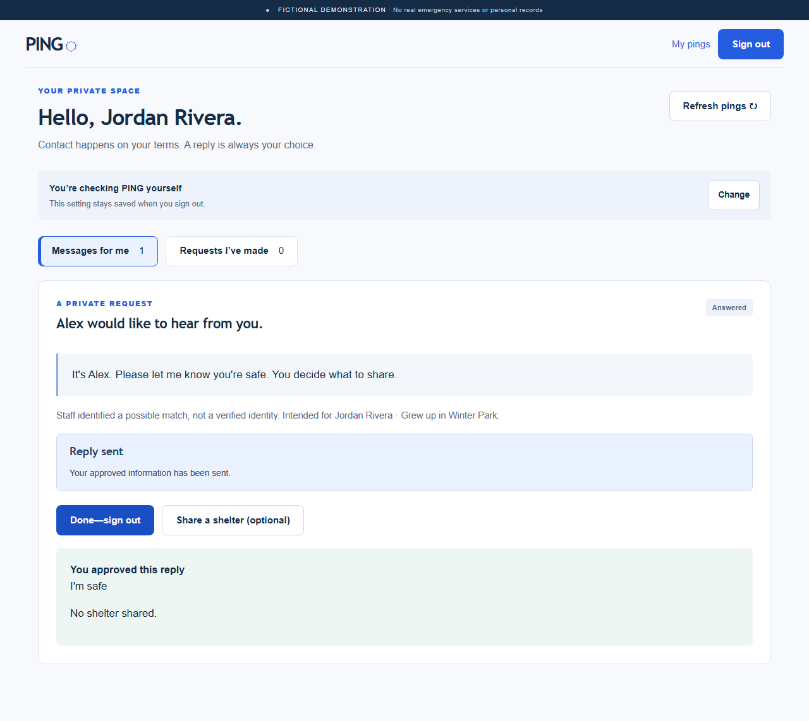

# PING · A little closer

PING is a fictional, consent-first contact-request prototype for the **DALI Fullstack Challenge 26F**. It lets separated people ask for contact through participating help desks without requiring a phone, email, government ID, or public location sharing.

The central question is: **How can someone ask whether another person is safe while leaving that person in control of whether to respond and what to reveal?** PING explores that question through a working browser application with a real database, resident accounts, staff-assisted intake, private messages and explicit consent. AI is used in the development process; it does not identify people, decide matches or approve disclosures in the app.

**Live demo:** [ping-davidg214.onrender.com](https://ping-davidg214.onrender.com). Select **Try the demo → Start my demo** to create your own fictional workspace. The free Render instance sleeps when idle; its first response may take 50 seconds or more.

**Repository:** [DavidG214/ping](https://github.com/DavidG214/ping). [Verified release CI](https://github.com/DavidG214/ping/actions/runs/39155143319) passed on October 18, 2026.

## Try it in five minutes

No installation or account creation needed. Use fictional data only. Keep the walkthrough in **one browser tab** so each role shares your demo workspace. To switch roles, reopen the [demo guide](https://ping-davidg214.onrender.com/demo) in that same tab; **do not reset** between steps.

| Step | What to do | What should happen |
|---|---|---|
| 1. Start | Open the live app → **Try the demo → Start my demo**. | **Choose a fictional role** appears. You have your own demo workspace. |
| 2. Route | Choose **Staff B**. Under **Looking for Jordan Rivera**, select **Jordan Rivera · 30–44**, then **Route possible match**. | A confirmation says the request is now available. |
| 3. Reply | Return to the demo guide → **Sign in as Jordan**. Credentials fill automatically. Choose **Yes, this device is shared** and **I'll check PING myself**, then **Open my pings**. Choose **Reply**, type **I'm safe**, and select **Preview my reply**. Leave shelter sharing unchecked. | The preview shows your exact message and **No shelter will be shared.** |
| 4. Send | Select **Send this reply**, then **Done—sign out**. Wait for the login screen before switching roles. | You see **Reply sent** before signing out; the login fields are cleared. |
| 5. Check | Return to the demo guide → **Sign in as Alex**. Answer both login questions, open your pings, then select **Requests I've made**. | Alex sees **I'm safe** and **No shelter was shared with this reply.** |

**Optional: test separate shelter consent.** Return as Jordan → **Share a shelter (optional)** → select **Lantern Center** → check **I am currently at this shelter** → **Preview shelter disclosure** → **Share this shelter**. Return as Alex and open **Requests I've made**: the reply now shows **Shared by the sender: Lantern Center**. It should appear only after that separate approval.

**Try again:** select **Reset my demo** in the demo guide, or use a fresh private browser window. Reset only replaces your fictional workspace. If a shared session expires while you are reading, return to the guide and sign in again; your submitted reply remains saved. Use **Sign out** when finished.

**Live walkthrough checked October 18:** Playwright completed the main example twice in fresh sessions, at desktop and tablet viewport sizes. All four public-site checks passed, including private decline/wrong-person decisions and the directory with map tiles blocked. These are Chromium checks, not physical iPad testing.

The rest of this README explains the purpose, features, design choices, and implementation in depth. [Verification evidence](docs/verification.md) records observed checks; [project reflection](docs/process-handoff.md) explains the development process and AI use.

## Contents

- [Purpose and people](#purpose-and-people)
- [The person behind the flow](#the-person-behind-the-flow)
- [Try the fictional story](#try-the-fictional-story)
- [What was built](#what-was-built)
- [Why these choices](#why-these-choices)
- [Design and privacy decisions](#design-and-privacy-decisions)
- [Architecture and stack](#architecture-and-stack)
- [Local setup](#local-setup)
- [Deployment](#deployment)
- [AI process and known limits](#ai-process-and-known-limits)



## Purpose and people

PING is designed around a difficult access constraint: people separated during disruption may not have their usual phone, email account or private computer available. Someone might be at a shelter, staying with relatives, or using a shared help-desk tablet. A contact tool that assumes a personal device and continuous connectivity would miss those situations.

At the same time, finding someone is not the same as having permission to contact them or learn where they are. A request may be mistaken, unwanted or unsafe. A public list showing where a person is staying could disclose far more than they intended. PING therefore makes the request private, asks staff to treat matches as uncertain, and gives the recipient the final decision about a response.

These are design assumptions and constraints for a challenge prototype. They are not findings from interviews, field deployment or formal humanitarian research. The app demonstrates a bounded workflow rather than claiming to solve disaster reunification as a whole.

| Person or role | What PING helps them do | What it does not authorize |
|---|---|---|
| Person seeking contact | Ask staff to submit a short message and limited identifying clues; later check for an approved reply | Track another person's location, see matching activity or demand a response |
| Recipient | Read a private ping, reply once, decline silently, report a wrong-person match, optionally share a shelter | Verify the requester's identity or retract information already sent |
| Volunteer/staff member | Register local residents, issue code-only cards, submit requests, review local candidates and deliver claimed assistance tasks | Reply or consent on a resident's behalf, browse cross-shelter resident profiles or override safeguarding |
| Assigned safeguarding staff | Review and acknowledge restricted referrals through a separate interface | Approve ordinary child/sensitive-case disclosure or complete custody/identity decisions in PING |
| Challenge reviewer | Start an isolated fictional scenario and try the roles without administrative setup | Enter real case data or use demo shortcuts outside that fictional workspace |

The same resident account can be a requester in one interaction and a recipient in another. Volunteer assistance is an additional delivery path; it does not remove the resident's ability to check their own inbox.

## The person behind the flow

A resident asks a volunteer to help find someone. Staff at another shelter review limited, seeker-supplied clues against their own local records. If there is a possible match, they route a private ping. The recipient chooses whether to reply and separately whether to share a shelter.

The requester sees only **Request received**, **Waiting for a response**, or **Response available**. Matching, reading, assistance, silent decline, wrong-person reports, and safeguarding decisions do not change that public-facing status. “Possible match” never means verified identity.

Residents at hotels or relatives' homes can check an existing account or visit a help desk. Help-desk affiliation is not a physical-location assertion. The prototype assumes some powered devices and intermittent internet; it supplies neither connectivity nor emergency response.

## Try the fictional story

Start with the [five-minute walkthrough](#try-it-in-five-minutes) above. Each demo workspace persists for up to 24 hours. Resident shortcuts fill fictional credentials, including demo PIN `001234`; both login questions still require a choice.

For a few additional checks, return to the demo guide and try:

| Role or screen | Try | Expected result |
|---|---|---|
| **Sam** | **This isn't me → Confirm** | The ping closes privately; Alex is not told about the wrong-person decision. |
| **Taylor** | **Don't respond → Confirm** | The ping closes privately; Alex is not told it was declined. |
| **Casey / Safeguarding staff** | Compare the restricted resident view with the assigned referral panel | Safeguarding acknowledgment stays separate from ordinary reply/location permission. |
| **Staff A** | **Register resident**, using a fictional adult and a six-digit PIN | An account-code card appears without the PIN. Local cases support creating another contact request. |
| **Help desks** | Open the directory | Three fictional desks have readable names and addresses, even if the map cannot load. |

Demo role controls are available only in demo mode and only for that browser's fictional workspace. They create server-scoped sessions; they cannot select arbitrary staff IDs, shelters, workspaces, or real accounts. All authorization still runs on the server. Do not enter real disaster or personal data.



## What was built

- Responsive home, login/help, resident inbox/outgoing requests, volunteer workspace, and safeguarding referral panel.
- Account-code/PIN authentication, PostgreSQL sessions, per-session device choice and persistent assistance preference.
- Manual local candidate review, private delivery, one approved reply, and separate per-request shelter consent.
- Wrong-person exclusions, silent decline, safeguarding blocks, assistance claims and handoff.
- Draggable/zoomable Leaflet map with three fictional help desks and an independent accessible directory list.
- Real PostgreSQL persistence, versioned SQL migrations, isolated demo seeds, idempotent workflow writes, audit events, and test/deployment configuration.

### Screens and everyday tasks

| Screen | Main task | Important behavior |
|---|---|---|
| Home | Check pings, request help, or find a desk | Three large actions fit a 1024×768 viewport without scrolling; staff sign-in and demo are secondary |
| Resident login | Enter an account code and six-digit PIN | Device sharing and assistance are separate, initially unselected questions at every login |
| Messages for me | Decide what to do with an incoming request | The message appears before its actions; Reply opens the composer; preview and Send are separate steps |
| Requests I've made | Read an approved reply | No recipient profile, unapproved shelter, match progress or reading status is exposed |
| Matching requests | Compare seeker-supplied clues with local residents | Staff choose a candidate manually; matching is always described as possible |
| Local cases | View existing requests, issue an authorized account card or add a request | Opening a case records access; the new-request form is expandable below existing requests |
| Register resident | Create an account and give the resident their code | Resident chooses the PIN; leading zeros survive; a failed card fetch can be retried without creating a duplicate account |
| Needs delivery | Assist someone who requested help checking PING | Staff must claim a task, then present or release it; a claim expires and is not a permanent case grant |
| Safeguarding | Acknowledge an assigned restricted referral | Displays a referral reference and reason; detailed external case linkage and case management remain outside this prototype |
| Help desks | Find a participating fictional desk | Complete text list stays usable when map tiles fail; the map contains desks, never people |

### A second walkthrough: assistance and handoff

1. Sign in as Alex and choose volunteer help, then use Staff B to route the Jordan request.
2. Open Staff B's **Needs delivery** task. Claim Jordan's incoming request to read it, release it to hand it off, or mark it presented after showing it privately.
3. Jordan still signs in personally, selects Reply and approves what to send. Marking an assistance task presented does not reply for Jordan.
4. Open Staff A's **Needs delivery** task. Alex's approved reply is available only after a valid local claim, and only approved content is shown.
5. If Jordan subsequently shares a shelter, the reply task is requeued. An already open claim is invalidated so stale content cannot be marked presented as though the new disclosure were delivered.
6. Disabling assistance cancels pending/claimed work. Server actions recheck authorization, and an open staff message is removed on its next poll or failed action. Information a volunteer already saw cannot be made unread.

This demonstrates coordination between the resident and desk. It does not simulate staffing levels, verify the person physically at the desk, or prove a volunteer actually delivered the message.

### What is deliberately deferred

No public person map, automatic/AI identity matching, SMS/email/push, photos, full chat, government integrations, offline private-record storage, or production child-reunification workflow. There is no automated account recovery or account merging.

A future **volunteer-reviewed public notice board** could publish minimal approved details, accept private tips to staff, and support moderation and removal. It must never publicly confirm a person's location. This is a future scope choice, not a rejection of the idea.

## Why these choices

The following rationale reflects the approved plans and decision logs. It explains the constraints behind the implementation rather than claiming that these choices have been validated in the field.

### Private contact requests instead of a public people directory

The useful outcome is a consensual exchange of information. Publishing names and locations would make discovery easier while also revealing that someone is present or reachable. A private request lets staff evaluate a possible local match and lets the recipient decide what, if anything, to disclose. Even declining is private: the requester continues to see the same waiting status.

### A code and PIN instead of email, phone or government ID

The access model should work for someone who cannot use their normal personal accounts. A printed account code and resident-chosen PIN make that possible without adding external identity services. This choice carries real costs: people can lose their card or forget their PIN, and a short PIN needs strong online throttling and careful credential storage. PING deliberately does not improvise an automatic recovery flow from names or birthdays.

### Two login questions instead of one combined assumption

Device ownership and ability to check messages are different facts. Someone with a personal device may still need assistance; someone using a shared tablet may prefer to check independently. The device answer controls the current session, while assistance is a persistent preference that can be changed later. All four combinations are valid and tested.

### Human-reviewed possible matches instead of automated identity decisions

A shared name or hometown is useful context, not proof. The prototype keeps matching manual and local, avoids automatic merges, and labels uncertainty directly. This makes the decision understandable and limits broad profile exposure. It also creates a staffing bottleneck and leaves mistakes possible; wrong-person handling and safeguarding restrictions are necessary parts of the flow.

### One reply and an exact preview instead of a chat system

The core interaction is small: communicate an approved message such as “I'm safe.” A full chat would add moderation, notification, retention and abuse-management questions beyond this prototype's scope. The exact preview creates a deliberate review point before disclosure. The server binds the approval to the content, recipient, delivery, action and expiration rather than trusting an editable client summary.

### Shelter sharing as a separate decision

A reply does not imply location consent. A desk affiliation is also not proof of where someone is staying. Shelter sharing is optional, off by default, scoped to a single requester and requires a current-presence statement. It can be included deliberately with a reply or added once later. The interface describes it as self-reported; the application does not verify physical presence.

### Temporary assistance claims instead of automatic permanent access

A volunteer needs enough access to deliver a particular message. Claiming that task should not silently grant access to the person's account card or complete outgoing case history. Task access therefore ends with release, presentation, expiry or opt-out. Explicit, audited local-case access remains a separate operation under the existing staff permissions.

### A simple shared-tablet home instead of a promotional landing page

The initial interface spent more space explaining the idea. The later review prioritized a person arriving with a task: check a message, ask for help, or find a desk. The redesign removed the illustration, promotional sections and large footer, kept the fictional-data notice, and made sign-out prominent. Staff navigation wraps on phones instead of hiding tasks in a horizontally scrolling tab strip.

### Memory-only drafts instead of browser storage

Losing an unfinished reply during an in-app refresh is frustrating. Leaving it in local storage on a shared device is a privacy problem. Drafts now stay in the mounted page's memory across in-app data refreshes and section changes. Logout, expiry and account changes clear them. A full reload also clears them; offline private-record caching is intentionally absent.

### A real backend and database instead of a frontend-only simulation

The important questions concern permissions, persistence, races and retries. Browser state alone cannot demonstrate those boundaries. PostgreSQL stores the workflow, credentials, sessions and retry receipts; the Express API checks permission on each operation. The local development setup runs actual PostgreSQL so tests exercise transactions and constraints instead of assuming an in-memory mock behaves the same way.

## Design and privacy decisions

The interface uses a calm blue help-desk palette, large readable controls, simple message cards and direct language. System font fallbacks keep private pages independent of font services. No disaster imagery, live-person dots, or false urgency.

### Credentials and sessions

- Codes contain 100 bits of cryptographic randomness, formatted as five groups of four characters. A code identifies an account; the PIN authenticates it.
- PINs are six-character strings, preserving leading zeros. They are salted Argon2id hashes (19 MiB, two iterations, parallelism one) after HMAC with a server-only pepper. PINs never appear on cards, in ordinary responses, or in logs.
- Code issuance is a dedicated, scoped card operation. The demo guide is an explicit exception exposing only seeded fictional credentials in its own workspace.
- Resident login always asks both device and assistance questions. Neither determines the other. Assistance persists after logout.
- Shared sessions warn at 90 seconds and expire after two idle minutes, with a 30-minute maximum. Personal sessions warn at 14 minutes and expire at 15, with an eight-hour maximum. Staff sessions warn at nine minutes and expire at 10, with an eight-hour maximum.
- Server deadlines are authoritative. Background reads do not renew sessions. HTTPS cookies are HttpOnly, Secure and SameSite Strict. Mutations require same-origin requests and CSRF tokens.
- Invalid login errors do not distinguish missing accounts from wrong PINs. Database-backed throttles allow five failed code attempts/15 minutes and 100 IP attempts/15 minutes. These prototype limits can inconvenience busy shared networks and need operational tuning.
- Private API responses are `no-store`; private data is not saved in browser storage. Logout clears state and notifies other tabs. Page restoration revalidates behind a privacy curtain.
- Cross-tab locking refreshes public session/CSRF metadata after cookie rotation without reopening the receiving tab's private screen. Its next sign-in starts a fresh private view.
- Offline logout immediately hides private screens and sets a non-sensitive lock marker; reconnecting revokes the old server session before access resumes. It cannot revoke a server session while disconnected.

### Consent and sensitive cases

One request supports one reply. A short-lived signed preview binds the exact outgoing content, resident, delivery, action, and expiration. Shelter sharing is optional and off by default, and may be separately added once after replying. It requires a current-location attestation and displays the exact public shelter name/address. This is self-reported, not independently verified. Sent information cannot be recalled in this demo.

Children, unknown ages, and recorded consent concerns cannot use ordinary delivery/reply/location release. A safeguarding account can acknowledge an assigned referral but cannot override disclosure. A claimed parent or matching clue is never permission. See [staff process](docs/staff-process.md).

The safeguarding screen currently exposes only its assigned referral reference, reason and acknowledgment state. It does not display the person's identity or a complete case record. That keeps the existing limited API projection, but means the app alone cannot connect a referral to an operational external intake record. This is a known limitation before any real use, not a complete safeguarding workflow. Safeguarding staff retain the pre-existing own-shelter staff permissions at the API level; the separate screen is not a new permission system.

### Assistance, mistakes, and outages

Assistance adds a delivery path; everyone still has an inbox. Enabling it queues actionable incoming requests and approved replies to the requester. Later explicit shelter consent reopens the relevant reply task. Disabling it cancels pending and claimed work without deleting pings. Claimed message access is rechecked at every server action and refreshed every five seconds in the staff panel; information already read cannot be made unread. Claims expire after 10 minutes or can be released for handoff.

If registration succeeds but its account card cannot load, staff can retry the card or reopen the authorized local case without creating another account.

Wrong-person and declined candidates cannot receive the same request again, while other candidates remain reviewable. Duplicate names never cause automatic merges. Broader harassment blocking across newly created requests remains future work.

Writes use actor-scoped idempotency keys and PostgreSQL transactions. A lost response is labeled **send status unknown**, not successful or definitely unsent. Retrying the same action returns the existing result. No connection means new pings cannot be exchanged; the UI points to staff/paper intake. Map tile failures do not block the directory or private flows.

## Architecture and stack

```text
React/Vite browser → same-origin Express API → PostgreSQL
                         │
                         └─ session + workspace + shelter + case authorization
Public directory only → OpenStreetMap tiles
```

TypeScript, React, Vite, Express, Zod, PostgreSQL, Drizzle's SQL migration runner, node-postgres parameterized queries, Argon2id, express-session/connect-pg-simple, Helmet, and Leaflet 1.9.4. Vitest/Supertest test API behavior against actual PostgreSQL; Playwright tests Chromium browser behavior.

`client/` contains screens and browser privacy handling; `server/` contains auth, authorization and workflow routes; `shared/` contains validation contracts; `db/` contains migrations and fictional fixtures. [API and access notes](docs/api.md) describe the public projections.

### Reading the code

| File or folder | Responsibility |
|---|---|
| `client/App.tsx` | Public routes, task-focused home, login, help and fictional demo guide |
| `client/Resident.tsx` | Incoming pings, outgoing request projections, reply and shelter previews, private decisions |
| `client/Staff.tsx` | Matching, registration, local cases, assistance and assigned safeguarding referrals |
| `client/session.tsx` | Privacy curtain, expiry warning, logout and cross-tab locking |
| `client/api.ts` | CSRF headers, request cancellation, retry keys and connection-error messaging |
| `client/ui.tsx` | Shared labeled fields and distinct loading/error/refresh states |
| `server/app.ts` | Same-origin server, session middleware, security headers, routes and error responses |
| `server/auth.ts` | Authentication, rate limits, session rotation and fictional demo capabilities |
| `server/context.ts` | Authorization helpers, transactions, mutation receipts, audit events and assistance queueing |
| `server/workflows.ts` | Resident-safe projections, signed previews, reply/location approval and decisions |
| `server/staff.ts` | Staff intake, local access, manual routing, claims and safeguarding acknowledgments |
| `shared/contracts.ts` | Runtime Zod validation and shared TypeScript types |
| `db/migrations/` | Checked-in SQL schema and additive migrations, run through Drizzle |
| `db/seed.ts` | Isolated fictional identities and reproducible review scenarios |
| `tests/api.test.ts` | Real PostgreSQL API and authorization checks |
| `tests/browser/` | User journeys, failure injection, shared-device privacy and layout checks in Chromium |
| `docs/` | Decisions, process/AI history, verification, API scope, staff guidance and release handoff |

### What happens when a reply is sent

1. The resident writes text and chooses whether to include a shelter. The browser requests a preview from the server.
2. The server checks the resident's delivery, current state and safeguarding restrictions, then returns the exact disclosure and a signed five-minute token.
3. The resident explicitly presses Send. The browser sends the token with a session CSRF token and an actor-scoped retry key.
4. In a PostgreSQL transaction, the server checks authorization, preview scope and expiry, current delivery state and any earlier receipt for the same action. It writes one response, updates delivery state, updates assistance work and records an audit event/receipt.
5. The requester endpoint exposes only the approved text and, if separately permitted, shelter disclosure. Internal candidate and delivery metadata stay out of that response.

This is also why a lost network response cannot simply be labeled “failed.” The database may already have committed. Retrying the same operation returns its recorded result instead of creating another response.

**Main technical tradeoff:** explicit Express endpoints make the frontend/backend boundary easy to inspect but require us to implement and test the unusual code/PIN session design carefully. PostgreSQL workspace-level advisory locks intentionally serialize workflow mutations in this small demo; this is not a high-throughput architecture.

**Biggest product tradeoff:** manual matching keeps uncertain identity decisions with staff and leaves disclosure to residents, but consumes volunteer time. A monitored handoff queue helps distribute work; it does not prove capacity for hundreds of thousands of people. PING has not been load-tested at disaster scale.

## Local setup

Requires Node 24 and npm. No global database installation is necessary on supported development machines.

```sh
npm ci --include=dev
npm run dev:db
```

Keep that terminal open. It starts native PostgreSQL on `127.0.0.1:55432`, with persistent data in ignored `.local/postgres`, creates `ping` and `ping_test`, and creates an ignored `.env` with random development secrets if one does not already exist. It does not install a Windows service. The local database password is intentionally development-only and must never be used for hosting.

In another terminal:

```sh
npm run db:migrate
npm run db:seed
npm run dev
```

Open **http://localhost:5173** (use localhost, matching `APP_ORIGIN`). The backend runs on port 3001. `db:seed` preserves existing workspaces; **Start my demo** creates private fixtures transactionally. Ctrl+C stops the processes, not the stored data. If PostgreSQL is already running, do not start a second copy.

Alternatively use an existing PostgreSQL server and fill `.env` from `.env.example`. `TEST_DATABASE_URL` must identify a dedicated database named `ping_test`; browser tests clear its contents. Never point tests at your deployed database.

### Environment

| Variable            | Purpose                                                                                   |
| ------------------- | ----------------------------------------------------------------------------------------- |
| `DATABASE_URL`      | Application PostgreSQL connection; use the managed provider's TLS URL in deployment       |
| `TEST_DATABASE_URL` | Dedicated `ping_test` database; tests can clear it                                        |
| `SESSION_SECRET`    | Independent random secret, at least 32 characters                                         |
| `PIN_PEPPER`        | Different random secret, at least 32 characters; changing it invalidates PIN verification |
| `APP_ORIGIN`        | Exact browser origin, no trailing slash; protects mutations                               |
| `NODE_ENV`          | `production` enables Secure cookies and deployment headers                                |
| `PORT`              | Backend listening port; supplied by Render                                                |
| `DEMO_MODE`         | `true` for this fictional prototype; must agree with the database marker                  |

The supplied migrations mark the database as demo-only. Turning demo mode off is not a production deployment procedure. There is no real-data onboarding or production account-recovery implementation.

### Checks

Latest release verification on **October 18, 2026**: Linux GitHub Actions passed **24 PostgreSQL API tests**, **29 Chromium browser scenarios**, and the complete build. The earlier local `npm audit` reported **zero known vulnerabilities**. Public-host checks also exercised the consent flow, isolated demo workspaces and secure session behavior. [Detailed evidence and remaining limits](docs/verification.md) records what each stage actually exercised.

```sh
npm run check
npm run build
npm test
npx playwright install chromium
npm run test:e2e
npm audit
```

Run API and browser suites sequentially: they share the dedicated test database. Browser tests start an isolated server on port 41937 and use the compiled frontend; build before running them. GitHub Actions runs these checks with a PostgreSQL service; the linked release run above was observed passing on GitHub.

On Windows, use `npm.cmd` and `npx.cmd` if PowerShell blocks the `.ps1` wrappers. The current preserved-copy setup shares installed dependencies with `../ping` through a local junction. A standalone checkout should install its own dependencies with `npm ci --include=dev`. Never copy `.env`, local PostgreSQL data, test artifacts or a dependency junction into a public repository.

The verification strategy has three layers: API tests exercise real database/authorization behavior; browser tests exercise the actual compiled screens and failure states; a separate AI review inspects code paths and combinations the tests may miss. None substitutes for physical-device checks, user research or public-host verification. The broad review found and fixed an assistance update ordering bug and a cross-tab login issue; the safeguarding intake-linkage limit remains visible above.

See [verification evidence](docs/verification.md) for observed results, failures/fixes, and unverified boundaries.

To repeat the public demo checks explicitly after installing dependencies and Chromium:

```sh
npx playwright test --config playwright.live.config.ts
```

This separate configuration runs against the live URL, creates four isolated fictional workspaces, and does not use database credentials or the local test-server reset. It checks the walkthrough at desktop and tablet sizes, private decisions, reload persistence, sign-out, and the map-failure fallback. It is an opt-in smoke suite, separate from the 29 local/CI browser scenarios. Avoid repeated rapid runs: public demo creation is limited to 10 starts per IP per hour. Screenshots are saved under ignored `test-results/live/`.

## Deployment

See [deployment instructions](docs/deployment.md). `render.yaml` supplies a single web service; Neon supplies persistent PostgreSQL. Never place SQLite or persistent records on Render's ephemeral filesystem.

As checked **October 16, 2026**, Render Free sleeps after 15 idle minutes and may take about a minute to wake. Its included hours, bandwidth, and build limits can interrupt access. Neon Free currently advertises 1 GB storage/project, 100 CU-hours/project/month, five-minute idle suspension and no fixed expiry. These are changing host policies, not guarantees. Render Free PostgreSQL expires after 30 days, so it is not the default. [Render limitations](https://render.com/docs/free), [Neon pricing](https://neon.com/pricing).

OpenStreetMap attribution is displayed on the map. Tiles are best-effort and must follow the [tile policy](https://operations.osmfoundation.org/policies/tiles/); there is no offline download or prefetch. Only the public directory loads external tiles, without resident data or precise user location.

## AI process and known limits

David supplied product decisions and the detailed privacy-first brief. Codex helped plan, implement, create fictional fixtures, write documentation and run tests. [AI-use log](docs/ai-use.md) and [decision log](docs/decisions.md) distinguish actual work and verification. No user research, clinical/legal validation, disaster-scale load test, or production security certification has occurred.

The [project reflection](docs/process-handoff.md) is a longer first-person account for combining with the original brainstorming chat. It explains David's product direction, privacy choices, scope discipline, interface iteration, and requests for deeper testing, alongside AI's implementation contributions. It summarizes the prompting approach without reproducing casual chat transcripts and identifies the context that belongs in the separate brainstorming record.

This is an educational prototype, not a production disaster-response system. It depends on honest staff intake, shared-device discipline, connectivity, database access and limited free hosting. Safeguarding and recovery require an organization's restricted human process. The public deployment and release CI were checked; actual shared tablets, Safari/Firefox, screen readers, real-world safeguarding and disaster-scale demand remain unverified.
